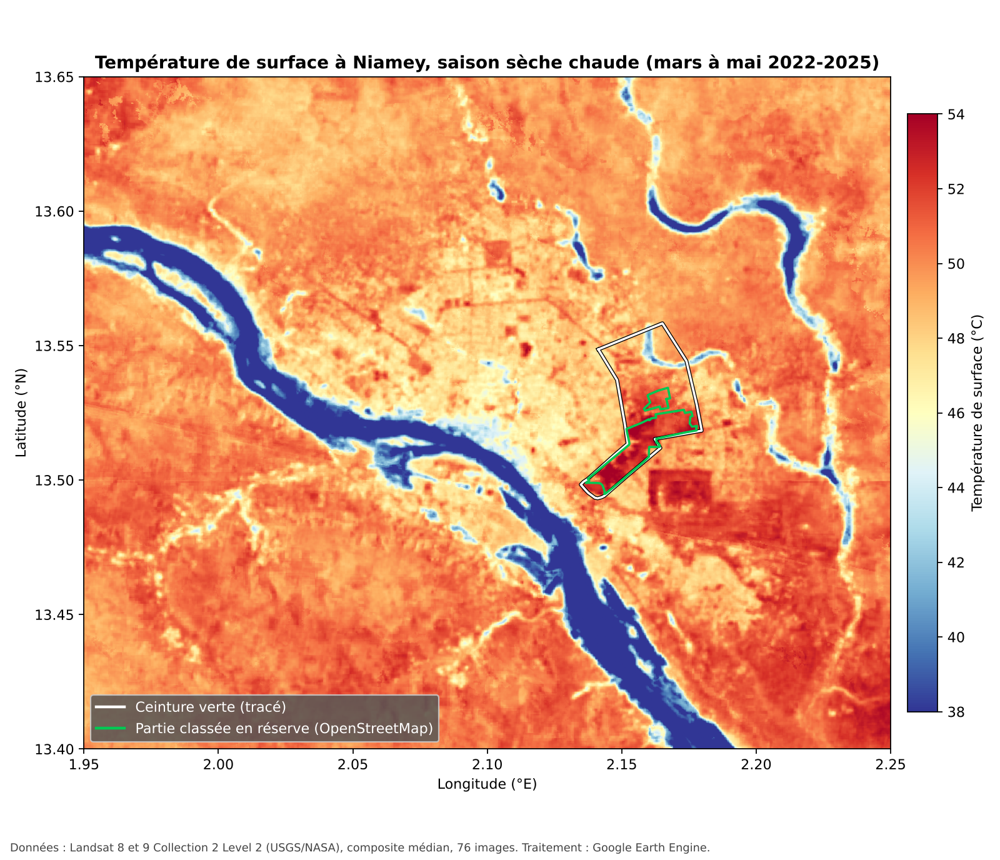
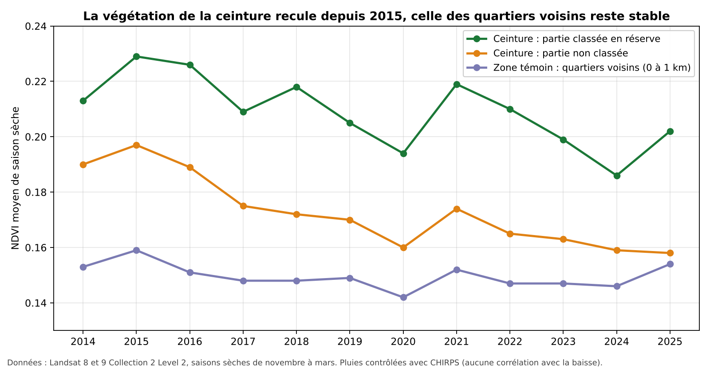

# Ceinture verte de Niamey : 40 ans de végétation vus par satellite

Créée en 1965 pour protéger Niamey contre la désertification et préserver son environnement, la ceinture verte présente aujourd'hui des températures de surface parmi les plus élevées de la ville sur les images thermiques Landsat. Dans sa partie classée en réserve, la part de végétation dense (NDVI de saison sèche supérieur à 0,25) passe d'environ 26 % en 2014 à 15 % en 2025. Cette évolution contraste avec la stabilité observée dans les quartiers voisins (zone témoin), ce qui suggère une cause locale plutôt que climatique. La progression des lotissements et du bâti dans cet espace protégé, déjà documentée par Banon et al. (2021), en constitue une explication plausible.



## Questions de recherche

1. La ceinture verte rafraîchit-elle encore la ville ?
2. Sa végétation a-t-elle reculé depuis les années 1980, et depuis quand ?
3. Ce recul est-il dû au climat (sécheresses) ou à une cause locale ?

## Données

| Donnée | Source | Usage |
|---|---|---|
| Landsat 5, 7, 8 et 9, Collection 2 Level 2 | USGS / NASA, via Google Earth Engine | Réflectance de surface (NDVI) et température de surface |
| CHIRPS, pluies quotidiennes | Climate Hazards Center, UC Santa Barbara | Contrôle de l'effet des pluies |
| ESA WorldCover 2021 | Agence spatiale européenne | Température par type d'occupation du sol |
| Contour de la réserve | OpenStreetMap (relation 8840816), licence ODbL | Zone d'étude |
| Tracé de la ceinture | Numérisation sur imagerie, novembre 2026 | Zone d'étude élargie |

## Méthode

**Température de surface.** Composite médian des images Landsat 8 et 9 de mars à mai 2022 à 2025 (76 images), saison la plus chaude avant la mousson. Masquage des nuages, ombres et cirrus (bande QA_PIXEL) et des pixels dont l'incertitude thermique dépasse 3 K (bande ST_QA). Conversion de la bande ST_B10 en degrés Celsius.

**Végétation.** NDVI calculé en saison sèche (novembre à mars), lorsque l'herbe est sèche : le signal vert restant vient alors surtout des arbres. Quatre époques (vers 1986, 2002, 2014 et 2025) puis une série annuelle de 2014 à 2025. Les réflectances de Landsat 5 et 7 sont harmonisées avec celles de Landsat 8 (coefficients de Roy et al., 2016) pour que la comparaison entre capteurs reste valable.

**Zone témoin.** Un anneau de 0 à 1 km autour de la ceinture. Si la baisse venait du climat, elle toucherait aussi les quartiers voisins.

**Contrôle des pluies.** Tendance du NDVI estimée en tenant compte du cumul de pluie de la saison précédente (CHIRPS).

## Résultats



| Zone | NDVI 2014 | NDVI 2025 | Végétation dense 2014 | Végétation dense 2025 |
|---|---|---|---|---|
| Ceinture, partie classée en réserve | 0,215 | 0,191 | 25,9 % | 14,8 % |
| Ceinture, partie non classée | 0,192 | 0,161 | 13,5 % | 9,5 % |
| Zone témoin (quartiers voisins) | 0,154 | 0,149 | 3,5 % | 3,0 % |

- La température de surface de la ceinture fait partie des plus élevées de Niamey, alors que les surfaces arborées de la ville sont 4 à 6 °C plus fraîches que les sols nus.
- La végétation reste stable jusqu'en 2014, puis recule presque chaque année.
- La zone témoin reste stable et la pluie n'explique pas la baisse : la cause est locale.


## Limites

- La zone témoin est surtout bâtie, avec un NDVI déjà bas : elle a moins de marge de baisse. Un second témoin rural renforcerait la preuve.
- Le seuil de végétation dense (NDVI supérieur à 0,25) est indicatif et n'a pas encore été validé sur le terrain.
- La série annuelle compte 12 années : les tests statistiques sont donnés à titre indicatif.
- La température de surface n'est pas la température de l'air, et Landsat passe vers 10 h 30, heure locale.
- Le tracé de la ceinture est une numérisation : sa base reste à confronter aux plans officiels.

## Reproduire l'analyse

1. Ouvrir l'éditeur de code [Google Earth Engine](https://code.earthengine.google.com).
2. Coller `gee/01_temperature_surface_niamey.js` pour la température de surface, ou `gee/02_ceinture_verte_evolution_ndvi.js` pour l'évolution de la végétation, puis cliquer sur **Run**.
3. Pour la carte interactive : `pip install -r requirements.txt`, remplacer `VOTRE_PROJET_GOOGLE_CLOUD` dans `python/carte_interactive_lst.py` par votre projet Google Cloud, puis lancer le script.

## Structure du dépôt

```
data/      contours de la ceinture (OpenStreetMap et tracé)
figures/   figures de ce README
gee/       scripts Google Earth Engine
python/    carte interactive (Folium)
```

## Références

- Banon, F., Danvidé, B. et Yattara Baye, A. (2021). Problématique de la gestion des espaces verts en milieu urbain : projet de conservation et de valorisation de la ceinture verte de Niamey au Niger. *Revue Écosystèmes et Paysages*, 1(1), 85-93.
- Roy, D. P. et al. (2016). Characterization of Landsat-7 to Landsat-8 reflective wavelength and normalized difference vegetation index continuity. *Remote Sensing of Environment*, 185, 57-70.
- Funk, C. et al. (2015). The climate hazards infrared precipitation with stations, a new environmental record for monitoring extremes. *Scientific Data*, 2, 150066.

## Auteur

**Karl Tancrède Boguhe**, géomaticien, Master de géomatique, Université Félix Houphouët-Boigny (Abidjan).
[LinkedIn](https://www.linkedin.com/in/karl-tancrede-boguhe)

Code sous licence MIT. Données Landsat : domaine public (USGS). Contours OpenStreetMap : © contributeurs OpenStreetMap, licence ODbL.
