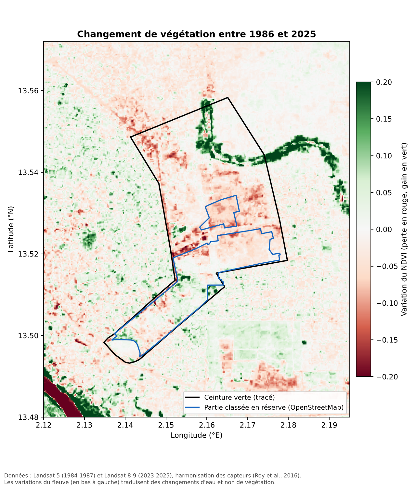

# Îlots de chaleur et ceinture verte de Niamey : 40 ans d'images satellite

Ce projet est parti d'une carte des îlots de chaleur de Niamey. Elle a révélé une surprise : la zone la plus chaude de la ville n'est pas un quartier dense, mais la ceinture verte, plantée à partir de 1965 pour protéger la ville du vent de sable et de la désertification. Dans sa partie classée en réserve, la surface atteint 52,6 °C en moyenne en saison chaude, soit 3,7 °C de plus que les quartiers qui la bordent. Pour comprendre pourquoi, j'ai suivi l'évolution de sa végétation sur quarante ans. La part de végétation dense (NDVI de saison sèche supérieur à 0,25) y avait progressé de 19 % en 1986 à 26 % en 2014, avant de retomber à 15 % en 2025. Les quartiers voisins restent stables et les pluies n'expliquent pas cette baisse, ce qui désigne une cause locale. La progression des lotissements et du bâti dans cet espace protégé, documentée par Banon et al. (2021), en constitue une explication plausible.


## Questions de recherche

1. Où se trouvent les îlots de chaleur de Niamey, et la ceinture verte rafraîchit-elle encore la ville ?
2. Sa végétation a-t-elle reculé depuis les années 1980, et depuis quand ?
3. Ce recul est-il dû au climat (sécheresses) ou à une cause locale ?
4. Pourquoi la réserve chauffe-t-elle autant ?

## Données

| Donnée | Source | Usage |
|---|---|---|
| Landsat 5, 7, 8 et 9, Collection 2 Level 2 | USGS / NASA, via Google Earth Engine | Réflectance de surface (NDVI, albédo) et température de surface |
| CHIRPS, pluies quotidiennes | Climate Hazards Center, UC Santa Barbara | Contrôle de l'effet des pluies |
| ESA WorldCover 2021 | Agence spatiale européenne | Température par type d'occupation du sol |
| Contour de la réserve | OpenStreetMap (relation 8840816), licence ODbL | Zone d'étude |
| Tracé de la ceinture | Numérisation sur imagerie, novembre 2026 | Zone d'étude élargie |

## Méthode

**Température de surface.** Composite médian des images Landsat 8 et 9 de mars à mai 2022 à 2025, saison la plus chaude avant la mousson. Seules les scènes couvertes à moins de 30 % par les nuages sont retenues (76 images). Masquage des nuages, ombres et cirrus (bande QA_PIXEL) et des pixels dont l'incertitude thermique dépasse 3 K (bande ST_QA). Conversion de la bande ST_B10 en degrés Celsius.

**Température par zone.** Moyenne du composite dans la réserve, dans la ceinture, dans la zone témoin, et par classe ESA WorldCover (bâti, arbres et sol nu).

**Albédo.** Albédo de surface calculé à partir des réflectances Landsat 8 de mars à mai, avec la formule de Liang (2001), pour comparer la part du rayonnement solaire renvoyée par chaque surface.

**Végétation.** NDVI calculé en saison sèche (novembre à mars), lorsque l'herbe est sèche : le signal vert restant vient alors surtout des arbres. Quatre époques (vers 1986, 2002, 2014 et 2025) puis une série annuelle de 2014 à 2025. Les réflectances de Landsat 5 et 7 sont harmonisées avec celles de Landsat 8 (coefficients de Roy et al., 2016) pour que la comparaison entre capteurs reste valable.

**Zone témoin.** Un anneau de 0 à 1 km autour de la ceinture. Si la baisse venait du climat, elle toucherait aussi les quartiers voisins.

**Contrôle des pluies.** Tendance du NDVI estimée en tenant compte du cumul de pluie de la saison précédente (CHIRPS).

## Résultats

### Température de surface (mars à mai 2022 à 2025)

| Zone | Température moyenne |
|---|---|
| Ceinture, partie classée en réserve | 52,6 °C |
| Ceinture entière | 50,5 °C |
| Sols nus de la zone d'étude | 49,7 °C |
| Zone témoin (quartiers voisins, 0 à 1 km) | 48,9 °C |
| Quartiers bâtis de Niamey | 47,8 °C |
| Zones arborées de Niamey | 44,3 °C |

- La réserve est plus chaude que 95 % des pixels de la zone d'étude.
- Le bâti est environ 2 °C plus frais que le sol nu : vers 10 h 30, les murs emmagasinent encore la chaleur et les ruelles restent à l'ombre. Les zones réellement arborées sont environ 5 °C plus fraîches que le sol nu.
- La réserve se comporte comme un sol nu, et même plus chaud. Sa végétation clairsemée n'évapore presque plus d'eau en saison chaude. Son sol est aussi plus sombre que le sable (albédo d'environ 0,23 contre 0,26), donc il absorbe davantage de rayonnement. Dans le bilan d'énergie Rn = H + LE + G, la chute de l'évaporation (LE) reporte l'énergie sur la chaleur sensible (H).

### Végétation


| Zone | NDVI 2014 | NDVI 2025 | Végétation dense 2014 | Végétation dense 2025 |
|---|---|---|---|---|
| Ceinture, partie classée en réserve | 0,215 | 0,191 | 25,9 % | 14,8 % |
| Ceinture, partie non classée | 0,192 | 0,161 | 13,5 % | 9,5 % |
| Zone témoin (quartiers voisins) | 0,154 | 0,149 | 3,5 % | 3,0 % |

Végétation dense dans la réserve aux quatre époques : 18,9 % (1986), 22,3 % (2002), 25,9 % (2014), 14,8 % (2025).

Tendance annuelle du NDVI de 2014 à 2025, pluies prises en compte :

| Zone | Tendance par an | t |
|---|---|---|
| Réserve | −0,0030 | −3,6 |
| Ceinture hors réserve | −0,0033 | −5,7 |
| Zone témoin | −0,0007 | −1,9 |

- La végétation de la réserve progresse jusqu'en 2014, puis recule presque chaque année.
- La zone témoin reste stable et la pluie n'explique pas la baisse : la cause est locale.



## Limites

- La chaleur de la réserve et le recul de sa végétation vont ensemble dans l'espace et dans le temps, mais le lien de cause n'est pas encore démontré. La prochaine étape est la série annuelle de l'écart de température entre la réserve et la zone témoin.
- La zone témoin est surtout bâtie, avec un NDVI déjà bas : elle a moins de marge de baisse. Un second témoin rural renforcerait la preuve.
- Le seuil de végétation dense (NDVI supérieur à 0,25) est indicatif et n'a pas encore été validé sur le terrain.
- La série annuelle compte 12 années : les tests statistiques sont donnés à titre indicatif.
- La température de surface n'est pas la température de l'air, et Landsat passe vers 10 h 30, heure locale.
- Les causes du recul (pression foncière, coupe de bois, entretien) restent à vérifier sur le terrain.
- Le tracé de la ceinture est une numérisation : sa base reste à confronter aux plans officiels.

## Reproduire l'analyse

1. Ouvrir l'éditeur de code [Google Earth Engine](https://code.earthengine.google.com).
2. Coller `gee/01_temperature_surface_niamey.js` pour la température de surface, ou `gee/02_ceinture_verte_evolution_ndvi.js` pour l'évolution de la végétation, puis cliquer sur **Run**.
3. Pour la carte interactive : `pip install -r requirements.txt`, remplacer `VOTRE_PROJET_GOOGLE_CLOUD` dans `python/carte_interactive_lst.py` par votre projet Google Cloud, puis lancer le script.

## Structure du dépôt

```
data/      contours de la ceinture (OpenStreetMap et tracé)
figures/   figures de ce README
gee/       scripts Google Earth Engine
python/    carte interactive (Folium)
```

## Références

- Banon, F., Danvidé, B. et Yattara Baye, A. (2021). Problématique de la gestion des espaces verts en milieu urbain : projet de conservation et de valorisation de la ceinture verte de Niamey au Niger. *Revue Écosystèmes et Paysages*, 1(1), 85-93.
- Funk, C. et al. (2015). The climate hazards infrared precipitation with stations, a new environmental record for monitoring extremes. *Scientific Data*, 2, 150066.
- Liang, S. (2001). Narrowband to broadband conversions of land surface albedo I: Algorithms. *Remote Sensing of Environment*, 76(2), 213-238.
- Roy, D. P. et al. (2016). Characterization of Landsat-7 to Landsat-8 reflective wavelength and normalized difference vegetation index continuity. *Remote Sensing of Environment*, 185, 57-70.

## Auteur

**Karl Tancrède Boguhe**, géomaticien, Master de géomatique, Université Félix Houphouët-Boigny (Abidjan).
[LinkedIn](https://www.linkedin.com/in/karl-tancrede-boguhe-57aa3829a)

Code sous licence MIT. Données Landsat : domaine public (USGS). Contours OpenStreetMap : © contributeurs OpenStreetMap, licence ODbL.
